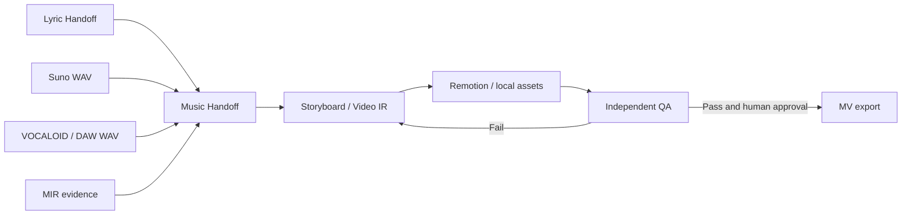

# AI-MUSIC-VIDEO-STUDIO

[](https://github.com/Gacky-Lab/AI-MUSIC-VIDEO-STUDIO/actions/workflows/offline.yml) · [Gacky-Lab research portfolio](https://github.com/Gacky-Lab/AI-MUSIC-VIDEO-STUDIO/blob/main/docs/profile/README.md)

AI音楽映像制作・自動編集・品質保証基盤 / Reproducible AI music video production framework.

**Status: Phase 1 candidate — 30-second Japanese synthetic preview, three-repository data flow and 14 technical checks verified in CI.** Windows runtime, real-song alignment, subjective video quality and paid generation remain NOT_RUN. Independent research, not affiliated with providers.



## Demo and alpha releases

- [Release downloads and notes](https://github.com/Gacky-Lab/AI-MUSIC-VIDEO-STUDIO/releases): initial alpha, synthetic preview only.
- [Verified Japanese 30-second demo (CI source)](https://github.com/Gacky-Lab/AI-MUSIC-VIDEO-STUDIO/actions/runs/45543328049): 1080p30, 14 technical checks passed; no real music or artistic-quality claim.

## Real-song production case study / 実曲MVの改稿事例

[「今日を抱いて帰る」の改稿記録](docs/REAL_SONG_MV_CASE_STUDY.md) documents a 3:16 MV made with song-specific Python/FFmpeg scripts. It covers creator-directed lyric typography revisions, five short animation sequences, and audio stream verification. Reproduction with this repository's renderer and comparative editing efficiency remain NOT_RUN.

## Documents
- [Requirements and architecture](docs/requirements.md)
- [Interface decisions and sources](docs/interfaces.md)
- [Implementation plan and DVP/DVR](docs/verification.md)
- [Music Handoff schema](schemas/music_handoff.schema.json)
- [Video IR schema](schemas/video_ir.schema.json)

## Offline quick start
Python 3.11+ and FFmpeg/FFprobe on PATH. No network or paid calls by the scripts.
```sh
python -m unittest discover -s tests -v
python scripts/smoke.py
```
Synthetic 15-second MP4 and report are written to ignored out/. This is a simple three-scene technical smoke test, not the Remotion production renderer or an artistic-quality test.

## Related projects
- [LYRIC-DESIGN-FRAMEWORK](https://github.com/Gacky-Lab/LYRIC-DESIGN-FRAMEWORK): Lyric Handoff v1.
- [SUNO-GENERATION-OPTIMIZER](https://github.com/Gacky-Lab/SUNO-GENERATION-OPTIMIZER): source audio candidates and evidence.
- [AI-MUSIC-INTELLIGENCE-ENGINE](https://github.com/Gacky-Lab/AI-MUSIC-INTELLIGENCE-ENGINE): future MIR and singing analysis; no existing API assumed.
- [AI-VOCALOID-STUDIO](https://github.com/Gacky-Lab/AI-VOCALOID-STUDIO): proposed Song IR and mastered audio.

No private music, credentials, signed URLs, proprietary assets or voicebanks. License undecided. Human approval required for paid calls and release.

## Portfolio and next milestone
- [Gacky-Lab portfolio README draft](docs/profile/README.md)
- [Conceptual portfolio architecture](docs/profile/architecture.svg)
- [P0b Remotion candidate / Windows bring-up](docs/P0B_REMOTION.md): synthetic motion graphic; Linux CI render and metadata checks passed. Windows repeat and visual inspection remain pending.

### Verified Remotion preview (Linux CI)

- [CI run and downloadable artifact](https://github.com/Gacky-Lab/AI-MUSIC-VIDEO-STUDIO/actions/runs/45542015749): 15 s, 1920×1080, 30 fps, 450 frames; all five independent stream checks passed. Synthetic test tone only.
- No paid generation API was used. This is not a real-song MV or an artistic-quality assessment. The generated package lock is in the CI artifact; dependency lock review and Windows verification remain open.

## P1 local lyric preview (synthetic verification passed)
[30-second local preview guide](docs/P1_LOCAL_PREVIEW.md): final WAV, Lyric Handoff v1, manually reviewed anchors and optional hash-bound MIR evidence. Synthetic 30-second render and four independent checks passed in [CI](https://github.com/Gacky-Lab/AI-MUSIC-VIDEO-STUDIO/actions/runs/45542889707); real-song acceptance remains NOT_RUN.

## Cross-project contract verification
[Cross-repository synthetic smoke](docs/CROSS_REPO_SMOKE.md) uses the actual pinned lyric exporter and MIR analyzer to produce Japanese caption and audio evidence inputs. [Seven contract checks passed](https://github.com/Gacky-Lab/AI-MUSIC-VIDEO-STUDIO/actions/runs/45543144307).

## Japanese end-to-end synthetic verification candidate
[Quality gates](docs/JAPANESE_RENDER_QA.md) extend the pinned upstream test through 30-second rendering, Japanese font availability, black-frame detection, sampled caption-region brightness, and one-second audio similarity. [Integrated CI passed](https://github.com/Gacky-Lab/AI-MUSIC-VIDEO-STUDIO/actions/runs/45543328049). Human review and real-song release remain blocked.

## Five-repository integration candidate

[Integration runner and Docker instructions](docs/FIVE_REPO_INTEGRATION.md). Offline synthetic pipeline with pinned upstream code, failure reports, and a local HTML evidence dashboard. Live Suno, vocal synthesis, and real-song quality are NOT_RUN. [Five-repository CI](https://github.com/Gacky-Lab/AI-MUSIC-VIDEO-STUDIO/actions/runs/45546958404) passed host and network-disabled Docker reproducibility plus 30-second video rendering and 7 independent render checks. [Expanded CI](https://github.com/Gacky-Lab/AI-MUSIC-VIDEO-STUDIO/actions/runs/45547270779) passed 11 stages, 309/309 eligible synthetic pitch frames within 35 cents, 60/60 note sequence and 35 ms maximum onset error; Docker artifacts matched and seven render checks passed.

## Local operation and security evidence

[Local loopback console](docs/LOCAL_CONSOLE.md) runs the synthetic pipeline only. [Security reports](docs/SECURITY_EVIDENCE.md) include scanner findings, not a clean-security assertion. [Latest alpha release](https://github.com/Gacky-Lab/AI-MUSIC-VIDEO-STUDIO/releases/tag/v0.2.0-alpha) includes synthetic video and evidence bundle once published.
