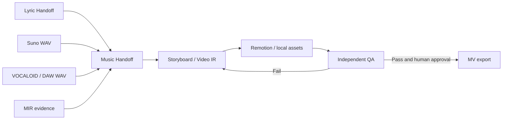

# AI-MUSIC-VIDEO-STUDIO
AI音楽映像制作・自動編集・品質保証基盤 / Reproducible AI music video production framework.

**Status: Design + Phase 0 FFmpeg smoke implementation.** Remotion, Windows, real-song alignment and paid generation are NOT_RUN. Independent research, not affiliated with providers.



## Documents
- [Requirements and architecture](docs/requirements.md)
- [Interface decisions and sources](docs/interfaces.md)
- [Implementation plan and DVP/DVR](docs/verification.md)
- [Music Handoff schema](schemas/music_handoff.schema.json)
- [Video IR schema](schemas/video_ir.schema.json)

## Offline quick start
Python 3.11+ and FFmpeg/FFprobe on PATH. No network or paid calls by the scripts.
```sh
python -m unittest discover -s tests -v
python scripts/smoke.py
```
Synthetic 15-second MP4 and report are written to ignored out/. This is a simple three-scene technical smoke test, not the Remotion production renderer or an artistic-quality test.

## Related projects
- [LYRIC-DESIGN-FRAMEWORK](https://github.com/Gacky-Lab/LYRIC-DESIGN-FRAMEWORK): Lyric Handoff v1.
- [SUNO-GENERATION-OPTIMIZER](https://github.com/Gacky-Lab/SUNO-GENERATION-OPTIMIZER): source audio candidates and evidence.
- [AI-MUSIC-INTELLIGENCE-ENGINE](https://github.com/Gacky-Lab/AI-MUSIC-INTELLIGENCE-ENGINE): future MIR and singing analysis; no existing API assumed.
- [AI-VOCALOID-STUDIO](https://github.com/Gacky-Lab/AI-VOCALOID-STUDIO): proposed Song IR and mastered audio.

No private music, credentials, signed URLs, proprietary assets or voicebanks. License undecided. Human approval required for paid calls and release.
