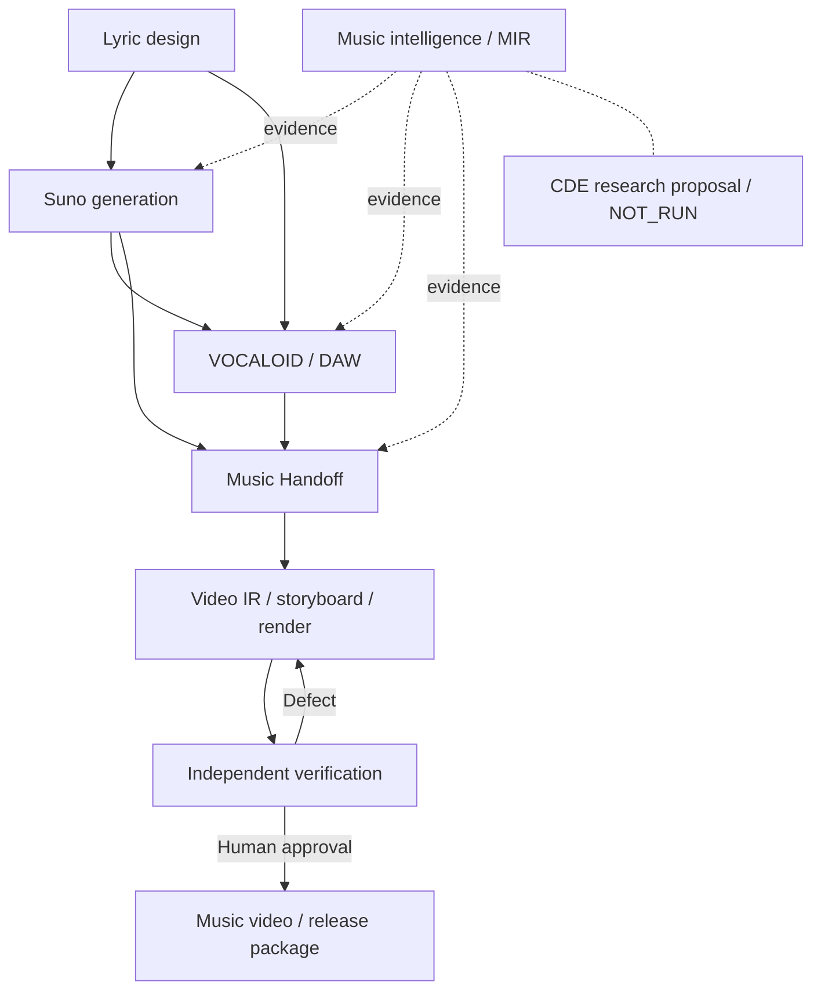

# Gacky-Lab
**Human-led creativity, engineering-driven production.**  
感性は人間に。検証はシステムに。

Independent research and engineering for reproducible AI music and music video production, and human–AI musical co-creation. This portfolio explores requirements engineering, music information retrieval, generative AI, singing synthesis, programmatic editing, and independent quality verification.

## Research portfolio
| Project | Focus | Evidence boundary |
|---|---|---|
| [LYRIC-DESIGN-FRAMEWORK](https://github.com/Gacky-Lab/LYRIC-DESIGN-FRAMEWORK) | Lyric design, emotional modeling, versioned handoff | Editorial framework and offline tests; listener efficacy unproven |
| [SUNO-GENERATION-OPTIMIZER](https://github.com/Gacky-Lab/SUNO-GENERATION-OPTIMIZER) | MCP generation, budgeted feedback, independent QA | Authorized generation and pilot experiments; optimization advantage unproven |
| [AI-MUSIC-INTELLIGENCE-ENGINE](https://github.com/Gacky-Lab/AI-MUSIC-INTELLIGENCE-ENGINE) | MIR, pitch/note candidates, evidence contracts; CDE research proposal | Offline WAV analysis and pinned handoff to MV preparation verified on synthetic inputs; real-song accuracy and CDE empirical validation unverified |
| [AI-VOCALOID-STUDIO](https://github.com/Gacky-Lab/AI-VOCALOID-STUDIO) | Song IR, vocal synthesis and DAW production | Offline interfaces; [owner-reported Windows asa 10s PoC in draft PR](https://github.com/Gacky-Lab/AI-VOCALOID-STUDIO/pull/1); faithful reproduction unverified |
| [AI-MUSIC-VIDEO-STUDIO](https://github.com/Gacky-Lab/AI-MUSIC-VIDEO-STUDIO) | Storyboard, timeline, rendering and video QA | 30s Japanese synthetic Remotion render and 14 cross-repository/technical checks verified; real-song integration unverified |

## Human–AI musical co-creation research

**[Creative Deviation Evaluation (CDE) v0.1](https://github.com/Gacky-Lab/AI-MUSIC-INTELLIGENCE-ENGINE/tree/main/research/creative-deviation-evaluation)** · Proposed / empirically unvalidated (NOT_RUN).

A research protocol for distinguishing preference for an unintended musical change from adoption of the whole edited artifact. It combines prospectively recorded preservation intent, verified changes, controlled restoration comparisons and delayed reassessment.

The goal is to investigate whether accepted works contain unwanted changes and rejected works contain desirable expressions. Candidate classes and reuse hypotheses are not automatic artistic judgements. No listening study, proven improvement, academic priority or cross-project CDE integration is claimed.

CDE is a research topic within AI-MUSIC-INTELLIGENCE-ENGINE, not a sixth repository or a verified production stage.

## Architecture

Conceptual interfaces, not a claim of operational end-to-end integration. CDE is a separate proposed research branch, not a verified production stage. Suno-only and vocaloid/DAW routes are both supported as design targets.

## Start here
- [Demo and release downloads](https://github.com/Gacky-Lab/AI-MUSIC-VIDEO-STUDIO/releases)
- [Japanese synthetic video: 14 technical checks passed](https://github.com/Gacky-Lab/AI-MUSIC-VIDEO-STUDIO/actions/runs/45543328049)
- [Suno alpha releases](https://github.com/Gacky-Lab/SUNO-GENERATION-OPTIMIZER/releases) · [Lyric alpha releases](https://github.com/Gacky-Lab/LYRIC-DESIGN-FRAMEWORK/releases) · [MIR alpha releases](https://github.com/Gacky-Lab/AI-MUSIC-INTELLIGENCE-ENGINE/releases) · [VOCALOID alpha releases](https://github.com/Gacky-Lab/AI-VOCALOID-STUDIO/releases)

## Reproducible evidence
- [Five-repository synthetic integration: 11 stages passed; host/Docker hashes matched](https://github.com/Gacky-Lab/AI-MUSIC-VIDEO-STUDIO/actions/runs/45547270779) — simulated generation and synthetic audio, not real-song or CDE validation.
- [30-second synthetic video and independent stream/audio checks](https://github.com/Gacky-Lab/AI-MUSIC-VIDEO-STUDIO/actions/runs/45542889707)
- [Three-repository synthetic contract test: 7/7 checks](https://github.com/Gacky-Lab/AI-MUSIC-VIDEO-STUDIO/actions/runs/45543144307)
- [MIR synthetic verification and JSON artifact](https://github.com/Gacky-Lab/AI-MUSIC-INTELLIGENCE-ENGINE/actions/runs/45542408140)

## Engineering principles
- Traceable requirements, explicit evidence and reproducible experiments.
- Separate provider feedback, independent technical QA and human artistic judgement.
- Human approval before paid generation or publication; preserve negative results.
- No credentials, private songs, proprietary voicebanks or unlicensed assets in public Git.

Next milestone: a verified 30-second lyric MV from an authorized final master.

Independent personal research, not affiliated with Suno, Yamaha, Crypton, Remotion or other providers. No blanket license is granted by this portfolio.
