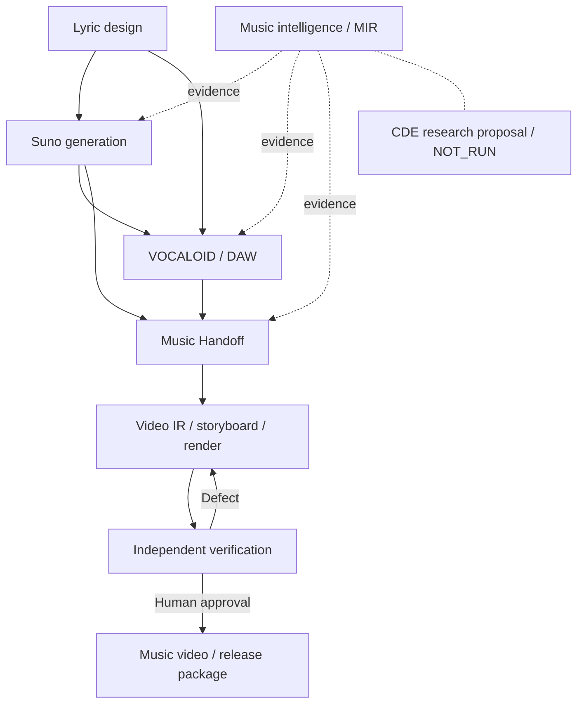

# Gacky-Lab

### From AI-generated music to human-directed creativity.
**AIで曲を作ることから、自分の音楽を作ることへ。**

Human-led creativity. Evidence-driven engineering.  
感性は人間に。検証はシステムに。

Gacky-Lab is an independent research initiative for music creators who want to refine AI-generated music into their own artistic expression. Its research covers creative intent, preservation of desired musical expressions, traceable production, and discovery of value in unexpected changes.

AIで生成した音楽を自分の表現として作り込みたいクリエイターのための独立研究プロジェクトです。創作意図の反映、音楽表現の保持、制作工程の再現性、意図外変化の創作価値を研究します。

## Who and why / 誰の何を解決するのか

Primary audience (hypothesis): independent AI music creators and vocal-synthesis/DAW producers who want to refine specific expressions. Secondary audience: music technology developers and co-creation researchers.

主対象（仮説）：生成した楽曲を細かく編集したい個人AI音楽クリエイター、ボカロP・DTM制作者。副対象：音楽技術開発者・共創研究者。

| Challenge / 課題 | Intended creator value / 目指す価値 |
|---|---|
| Controllability / 制御性 | Change intended elements; preserve desired expressions. / 意図した修正と表現の保持 |
| Reproducibility / 再現性 | Trace production conditions and decisions. / 制作条件と判断の追跡 |
| Creative discovery / 創造的発見 | Investigate unexpected changes and their potential reuse. / 偶然の価値の発見と再利用可能性の検証 |

The [canonical bilingual profile and market hypotheses](https://github.com/Gacky-Lab/Gacky-Lab/blob/main/README.md#market-hypotheses--市場課題仮説) define six provisional market problems (MP-01–MP-06). The initial priorities are preservation during editing (MP-05) and generation effort/cost (MP-02). The first validation scenario is a short lyric edit with a specified musical expression preserved, compared against available editing methods.

[正式プロフィール・市場課題仮説](https://github.com/Gacky-Lab/Gacky-Lab/blob/main/README.md)を上位の研究方針とします。初期優先課題は修正時の表現保持（MP-05）と再生成負担（MP-02）です。最初の検証は短い歌詞修正と指定した表現の保持を既存手段と比較します。市場ニーズの代表性・比較優位・実用上の効果は未実証です。

## Research portfolio
| Project | Focus | Evidence boundary |
|---|---|---|
| [LYRIC-DESIGN-FRAMEWORK](https://github.com/Gacky-Lab/LYRIC-DESIGN-FRAMEWORK) | Lyric design, emotional modeling, versioned handoff | Editorial framework and offline tests; listener efficacy unproven |
| [SUNO-GENERATION-OPTIMIZER](https://github.com/Gacky-Lab/SUNO-GENERATION-OPTIMIZER) | MCP generation, budgeted feedback, independent QA | Authorized generation and pilot experiments; optimization advantage unproven |
| [AI-MUSIC-INTELLIGENCE-ENGINE](https://github.com/Gacky-Lab/AI-MUSIC-INTELLIGENCE-ENGINE) | MIR, pitch/note candidates, evidence contracts; CDE research proposal | Offline WAV analysis and pinned handoff to MV preparation verified on synthetic inputs; real-song accuracy and CDE empirical validation unverified |
| [AI-VOCALOID-STUDIO](https://github.com/Gacky-Lab/AI-VOCALOID-STUDIO) | Song IR, vocal synthesis and DAW production | Offline interfaces; [owner-reported Windows asa 10s PoC in draft PR](https://github.com/Gacky-Lab/AI-VOCALOID-STUDIO/pull/1); faithful reproduction unverified |
| [AI-MUSIC-VIDEO-STUDIO](https://github.com/Gacky-Lab/AI-MUSIC-VIDEO-STUDIO) | Storyboard, timeline, rendering and video QA | 30s Japanese synthetic Remotion render and 14 cross-repository/technical checks verified; real-song integration unverified |

## Human–AI musical co-creation research

**[Creative Deviation Evaluation (CDE) v0.1](https://github.com/Gacky-Lab/AI-MUSIC-INTELLIGENCE-ENGINE/tree/main/research/creative-deviation-evaluation)** · Proposed / empirically unvalidated (NOT_RUN).

A research protocol for distinguishing preference for an unintended musical change from adoption of the whole edited artifact. It combines prospectively recorded preservation intent, verified changes, controlled restoration comparisons and delayed reassessment.

The goal is to investigate whether accepted works contain unwanted changes and rejected works contain desirable expressions. Candidate classes and reuse hypotheses are not automatic artistic judgements. No listening study, proven improvement, academic priority or cross-project CDE integration is claimed.

CDE is a research topic within AI-MUSIC-INTELLIGENCE-ENGINE, not a sixth repository or a verified production stage.

## Architecture

Conceptual interfaces, not a claim of operational end-to-end integration. CDE is a separate proposed research branch, not a verified production stage. Suno-only and vocaloid/DAW routes are both supported as design targets.

## Start here
- [Demo and release downloads](https://github.com/Gacky-Lab/AI-MUSIC-VIDEO-STUDIO/releases)
- [Japanese synthetic video: 14 technical checks passed](https://github.com/Gacky-Lab/AI-MUSIC-VIDEO-STUDIO/actions/runs/45543328049)
- [Suno alpha releases](https://github.com/Gacky-Lab/SUNO-GENERATION-OPTIMIZER/releases) · [Lyric alpha releases](https://github.com/Gacky-Lab/LYRIC-DESIGN-FRAMEWORK/releases) · [MIR alpha releases](https://github.com/Gacky-Lab/AI-MUSIC-INTELLIGENCE-ENGINE/releases) · [VOCALOID alpha releases](https://github.com/Gacky-Lab/AI-VOCALOID-STUDIO/releases)

## Reproducible evidence
- [Five-repository synthetic integration: 11 stages passed; host/Docker hashes matched](https://github.com/Gacky-Lab/AI-MUSIC-VIDEO-STUDIO/actions/runs/45547270779) — simulated generation and synthetic audio, not real-song or CDE validation.
- [30-second synthetic video and independent stream/audio checks](https://github.com/Gacky-Lab/AI-MUSIC-VIDEO-STUDIO/actions/runs/45542889707)
- [Three-repository synthetic contract test: 7/7 checks](https://github.com/Gacky-Lab/AI-MUSIC-VIDEO-STUDIO/actions/runs/45543144307)
- [MIR synthetic verification and JSON artifact](https://github.com/Gacky-Lab/AI-MUSIC-INTELLIGENCE-ENGINE/actions/runs/45542408140)

## Engineering principles
- Traceable requirements, explicit evidence and reproducible experiments.
- Separate provider feedback, independent technical QA and human artistic judgement.
- Human approval before paid generation or publication; preserve negative results.
- No credentials, private songs, proprietary voicebanks or unlicensed assets in public Git.

Next milestones: controlled preservation/edit comparisons (MP-05), matched generation effort comparisons (MP-02), a CDE listening pilot, and a verified 30-second lyric MV from an authorized final master. These are research targets, not achieved outcomes. / 次の検証目標：表現保持、再生成負担、CDE試聴、許諾済み音源でのMV制作。

Independent personal research, not affiliated with Suno, Yamaha, Crypton, Remotion or other providers. No blanket license is granted by this portfolio.
