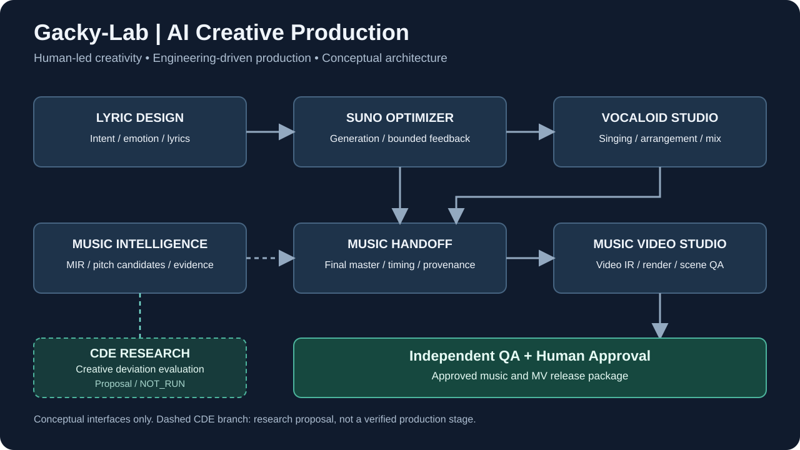
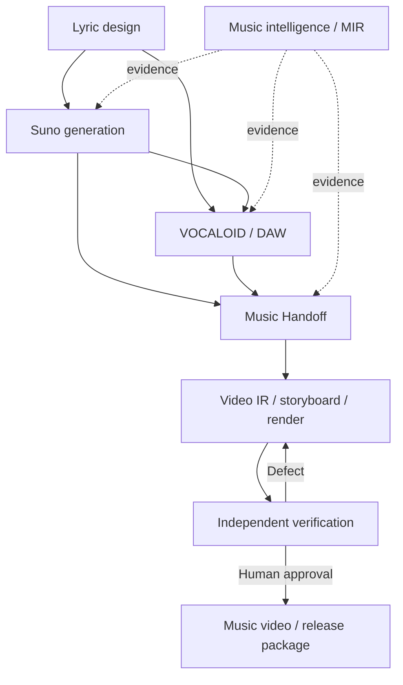

# Gacky-Lab
**Human-led creativity, engineering-driven production.**  
感性は人間に。検証はシステムに。

Independent research and engineering for reproducible AI music and music video production. This portfolio explores requirements engineering, music information retrieval, generative AI, singing synthesis, programmatic editing, and independent quality verification.

## Research portfolio
| Project | Focus | Evidence boundary |
|---|---|---|
| [LYRIC-DESIGN-FRAMEWORK](https://github.com/Gacky-Lab/LYRIC-DESIGN-FRAMEWORK) | Lyric design, emotional modeling, versioned handoff | Editorial framework and offline tests; listener efficacy unproven |
| [SUNO-GENERATION-OPTIMIZER](https://github.com/Gacky-Lab/SUNO-GENERATION-OPTIMIZER) | MCP generation, budgeted feedback, independent QA | Authorized generation and pilot experiments; optimization advantage unproven |
| [AI-MUSIC-INTELLIGENCE-ENGINE](https://github.com/Gacky-Lab/AI-MUSIC-INTELLIGENCE-ENGINE) | MIR, transcription, expression and evaluation | Offline WAV analysis and pinned handoff to MV preparation verified on synthetic inputs; real-song accuracy unverified |
| [AI-VOCALOID-STUDIO](https://github.com/Gacky-Lab/AI-VOCALOID-STUDIO) | Song IR, vocal synthesis and DAW production | Offline interfaces; [owner-reported Windows asa 10s PoC in draft PR](https://github.com/Gacky-Lab/AI-VOCALOID-STUDIO/pull/1); faithful reproduction unverified |
| [AI-MUSIC-VIDEO-STUDIO](https://github.com/Gacky-Lab/AI-MUSIC-VIDEO-STUDIO) | Storyboard, timeline, rendering and video QA | 30s synthetic Remotion render and cross-repository input contracts verified; real-song integration unverified |

## Architecture

Conceptual interfaces, not a claim of operational end-to-end integration. Suno-only and vocaloid/DAW routes are both supported as design targets.

## Reproducible evidence
- [30-second synthetic video and independent stream/audio checks](https://github.com/Gacky-Lab/AI-MUSIC-VIDEO-STUDIO/actions/runs/45542889707)
- [Three-repository synthetic contract test: 7/7 checks](https://github.com/Gacky-Lab/AI-MUSIC-VIDEO-STUDIO/actions/runs/45543144307)
- [MIR synthetic verification and JSON artifact](https://github.com/Gacky-Lab/AI-MUSIC-INTELLIGENCE-ENGINE/actions/runs/45542408140)

## Engineering principles
- Traceable requirements, explicit evidence and reproducible experiments.
- Separate provider feedback, independent technical QA and human artistic judgement.
- Human approval before paid generation or publication; preserve negative results.
- No credentials, private songs, proprietary voicebanks or unlicensed assets in public Git.

Next milestone: a verified 30-second lyric MV from an authorized final master.

Independent personal research, not affiliated with Suno, Yamaha, Crypton, Remotion or other providers. No blanket license is granted by this portfolio.
