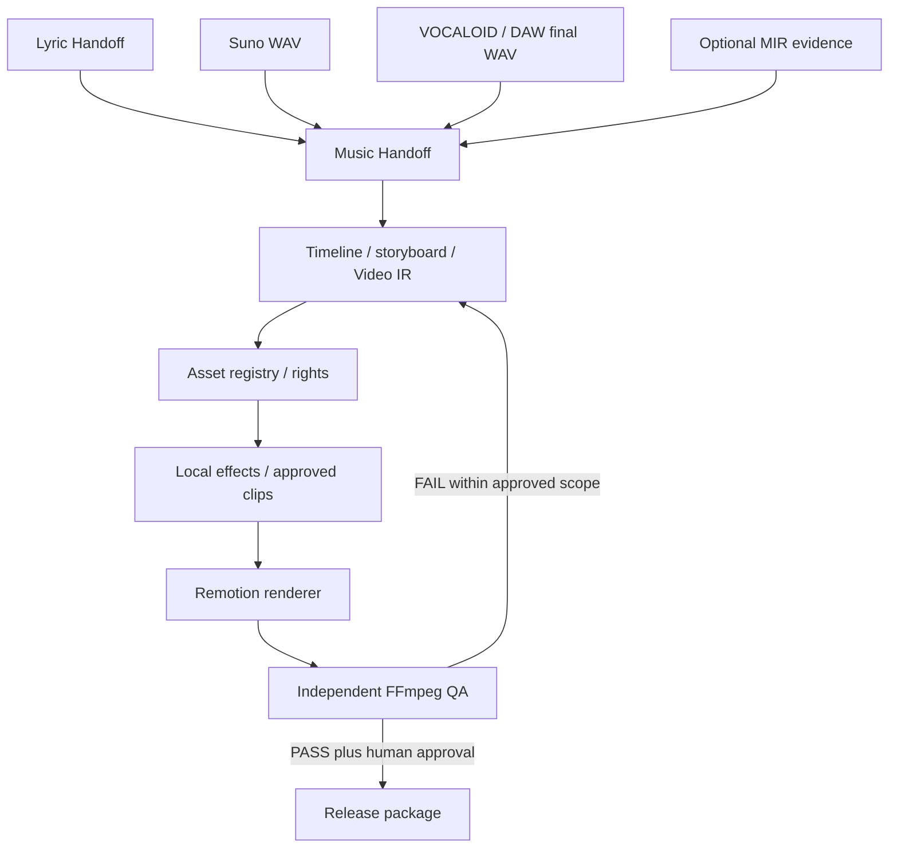

# AMVS-SRS-001 v0.1.0 — 2026-11-25 JST
## Purpose and scope
歌詞・完成マスター音源を入力し、絵コンテ、素材選定、時間同期、映像レンダリング、独立検査まで再現可能な工程にする。ChatGPT Plus/Codex/VS Code は開発・企画支援であり、本番ランタイムの必須依存にしない。Windows 11・個人利用・1080p30・16:9を初期対象とする。9:16は再レイアウト、4Kは後続。外部API費用は別。商用成果や自律性は未実証。

## Architecture

Suno直結とVOCALOID再制作の両方を許容する。最終マスターが変わればタイムラインを無効化。歌詞原文は上流を正本にし、分析器の推定で上書きしない。MIRは当初ローカル暫定アダプタ、後に音楽解析リポジトリと契約を合わせる。依存方向は一方向。上流を変更しない。

## Requirements and verification
| ID | Requirement | Verification |
|---|---|---|
| R01 | WAVハッシュ、歌詞版、出所、権利情報を照合 | 不一致を拒否 |
| R02 | 最終音源でビート、セクション、歌詞時刻を推定・人間修正 | 手動基準との誤差 |
| R03 | 感情座標と歌詞から絵コンテ案・素材リスト | 人間承認 |
| R04 | 固定fps整数フレームのVideo IR | シーン境界・重複・空白を検査 |
| R05 | イラスト/文字/光/カメラ/粒子の描画 | 合成15秒、実曲30秒 |
| R06 | 生成動画は任意アダプタ | 明示予算、認証・能力確認 |
| R07 | 独立QA | FFprobe、黒画面、無音、音源照合 |
| R08 | シーン単位修正・依存変更でキャッシュ無効化 | 差分試験 |
| R09 | 予算予約・永続記録・結果照合 | 模擬タイムアウトと再起動 |
| R10 | 人間承認なしに公開しない | 状態遷移 |
| R11 | 秘匿情報・権利未確認素材を公開しない | 自動検査＋目視 |
| R12 | 入力、設定、ツール版、素材ハッシュによる再現 | 同一環境の比較、バイト一致は保証しない |

## Control
DRAFT → INPUT_VERIFIED → STORYBOARD_APPROVED → ASSETS_READY → RENDERED → QA_PASS → HUMAN_APPROVED → EXPORT_READY.
必須項目の UNKNOWN / FAIL / NOT_RUN は公開不可。外部生成は別状態機械 PROPOSED → RESERVED → SUBMITTED → RECONCILED → SETTLED。応答不明は UNKNOWN_PENDING、再送禁止。タスクIDと利用量を照合するまで予約維持。最大試行数、価格有効期限、通貨、上限、承認者を記録。失敗時は静止画演出への代替可（人間承認）。キャッシュキーは素材ハッシュ、シーン仕様、レンダラー版、設定を含む。費用削減・品質改善は実験で判断する。

## Visual strategy
L1: stills + parallax/typography/beat-driven transitions (default). L2: L1 plus selected short image-to-video clips at chorus peaks (opt-in budget). L3: full animation/3D only after comparative evaluation. Use a character/style bible, scene references and human continuity review; do not infer visual appeal solely from audio metrics. Avoid unsafe flashing; include readable captions and safe margins. No automatic upload.
